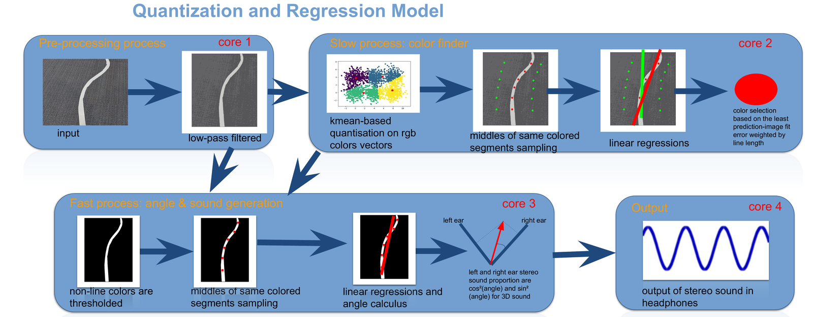
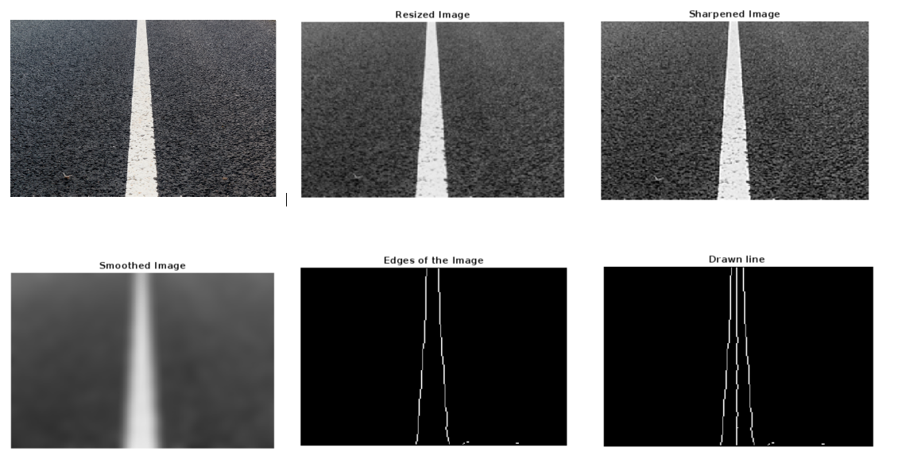

# Hold The Line : guidage audio par suivi de ligne pour personnes malvoyantes

Projet de semestre en équipe de cinq (septembre 2022 à janvier 2023) : un Raspberry Pi 4 équipé d'une caméra filme une ligne tracée au sol, en estime l'angle par rapport à la direction de marche et guide l'utilisateur par un son stéréo dans un casque. Le système a été développé en MATLAB/Simulink et déployé sur la carte.



*Pipeline embarqué (extrait du poster du projet) : un processus lent identifie la couleur de la ligne (k-means puis régressions), un processus rapide seuille l'image sur cette couleur, échantillonne les milieux de la ligne, en déduit l'angle par régression linéaire et génère le son.*

## Problème

Une personne malvoyante qui veut marcher ou courir seule sur un parcours balisé n'a aucun retour sur sa trajectoire. L'objectif était de construire un dispositif portable et peu coûteux qui suit une ligne au sol et traduit l'écart de direction en indication sonore. Le dispositif ne nécessite ni écran ni interaction.

## Approche

**Matériel** (poster) : Raspberry Pi 4 Model B 2 Go alimenté par un PiJuice HAT, Raspberry Pi Camera Module 2, casque audio.

**Quatre méthodes de détection explorées** (rapport, §2) :

| Méthode | Principe | Statut |
|---|---|---|
| Contours actifs (*snakes*) | courbe déformable minimisant une énergie (attache aux bords + régularité) | MATLAB, images fixes ([`matlab/approaches/contouractif.m`](matlab/approaches/contouractif.m)) |
| Middle edge | compression, renforcement, lissage, puis détection de bords (LoG) et tracé du milieu des deux bords ligne par ligne | fonctionne sous MATLAB sur images fixes, erreurs sous Simulink ([`draw_line__1_.m`](matlab/approaches/draw_line__1_.m)) |
| Transformée de Radon | filtre médian, Canny, puis Radon pour trouver l'orientation dominante | MATLAB ; coûteuse (O(n²)) et limitée aux lignes droites ([`find_line_radon.m`](matlab/approaches/find_line_radon.m)) |
| **Quantification + régression** | k-means sur les couleurs RVB, choix de la couleur de la ligne, échantillonnage des milieux de segments, régression linéaire | **seule méthode déployée sur le Raspberry Pi** ([`simulink/projects5.slx`](simulink/projects5.slx)) |

<p align="center"></p>

*Méthode « middle edge » sur une image fixe (rapport, §2.2).*

**Parallélisme** : la méthode déployée est découpée en deux tâches. La tâche A, lente, quantifie l'image et met à jour la couleur de référence de la ligne. La tâche B, rapide, ne garde que cette couleur, calcule l'angle et produit le son. Les deux tournent en parallèle sur les cœurs du Raspberry Pi.

**Sortie audio** : une sinusoïde dont les volumes gauche et droit valent sin² et cos² de (angle + π/4), saturés au-delà de ±45°. Les deux volumes somment à 1 ([`findsound.m`](matlab/simulink_blocks/findsound.m)). La musique *Hold the Line* (Toto) était prévue, mais provoquait un dépassement de capacité sous Simulink.

## Résultats

| Mesure | Valeur | Source |
|---|---|---|
| Essais de suivi de ligne réussis | **20 / 20** | rapport §5.2 ; poster, encadré « Results » |
| Charge processeur pendant les essais | ≈ 20 %, RAM presque vide | poster, encadré « Results » |
| Utilisation des cœurs | aucun des 4 cœurs saturé | rapport §5.3 |

L'équipe en conclut que le Raspberry Pi 4 est surdimensionné pour cette tâche, et qu'un micro-ordinateur moins puissant suffirait et réduirait le coût. Les conditions des 20 essais (parcours, éclairage, vitesse de marche) ne sont pas détaillées dans les documents, et aucune mesure de latence n'a été publiée.

## Démo en ligne

**[elliotbch.github.io/hold_the_line](https://elliotbch.github.io/hold_the_line/)** : rien à installer, tout le calcul se fait dans le navigateur.

La démo existe en deux versions : un site statique (dossier [`site/`](site/), publié sur GitHub Pages) qui exécute le code Python de `holdtheline/` directement dans le navigateur grâce à Pyodide (NumPy, SciPy, OpenCV, scikit-image en WebAssembly), et une API FastAPI (dossier [`demo/`](demo/)) à lancer en local ou avec Docker.

Une démo web permet de choisir une image d'exemple ou d'importer une photo d'une ligne au sol, de voir l'image annotée (ligne détectée, points échantillonnés, angle), de lire l'angle en degrés et d'entendre le retour stéréo dans le navigateur (Web Audio API : volumes gauche/droite de `findsound.m`, onde carrée à 100 Hz comme dans le modèle Simulink). Un mode webcam traite une image par seconde (localement dans la version en ligne, sur le serveur dans la version API). Trois méthodes sont portées en Python dans [`holdtheline/`](holdtheline/), chacune en citant le fichier `.m` d'origine :

| Méthode | Source MATLAB | Portage Python |
|---|---|---|
| Quantification + régression linéaire sur les milieux (déployée) | `matlab/simulink_blocks/rgbtoimg.m`, `findcolor.m`, `findsound.m` | `holdtheline/quantization.py` |
| Middle edge | `matlab/approaches/draw_line__1_.m` | `holdtheline/middle_edge.py` |
| Transformée de Radon | `matlab/approaches/find_line_radon.m` | `holdtheline/radon_method.py` |

Les paramètres du code MATLAB sont conservés (images 320×240 et 20 couleurs lus dans `simulink/projects5.slx`, filtres 18×18 et 16×16, etc.). Quelques erreurs d'indexation du code d'origine sont corrigées selon l'intention affichée, et signalées en commentaire : remise en forme des étiquettes k-means, rayon de la « sphère » de couleur, repliement θ/θ+90° de Radon qui perdait le signe, et loi stéréo de `findsound.m` (le `+ π/2` rendait le son toujours saturé à gauche ou à droite). Le son est joué du côté vers lequel on dérive, comme dans les branches saturées du bloc déployé : il faut s'en éloigner.

**Évaluation** ([`demo/eval_metrics.json`](demo/eval_metrics.json), `python scripts/evaluate.py`) : erreur angulaire sur 60 images **synthétiques** (sol texturé asphalte / béton / moquette, ligne blanche ou jaune, 30 droites et 30 courbes, angle de référence connu), générées par `holdtheline/synthetic.py` avec des graines non utilisées pendant la mise au point. Aucune photo réelle avec un angle mesuré n'était disponible : ces chiffres ne disent rien de la précision sur le terrain.

| Méthode | Lignes trouvées | Erreur moyenne | Droites | Courbes | Temps / image |
|---|---|---|---|---|---|
| Quantification + régression | 37 / 60 | 5,4° | 0,9° | 8,4° | 150 ms |
| Middle edge | 60 / 60 | 2,1° | 1,4° | 2,8° | 18 ms |
| Radon | 60 / 60 | 3,6° | 1,1° | 6,0° | 212 ms |

*Erreur moyenne calculée sur les images où une ligne est trouvée. Temps mesurés sur Apple M2 Pro. La méthode déployée échoue surtout sur les lignes étroites : à 320 px de large, le flou 18×18 puis le filtre médian 16×16 effacent une ligne de moins d'environ 10 % de la largeur de l'image.*

- Version en ligne (statique) : https://elliotbch.github.io/hold_the_line/ ; en local : `python3 -m http.server 8000 -d site`. Après une modification de `holdtheline/`, `sh site/sync_py.sh` met à jour la copie dans `site/py/` (le workflow `.github/workflows/pages.yml` le fait aussi avant de publier). Fidélité au serveur : `site/tests/parity.py` puis `site/tests/parity.html`.
- Version API (FastAPI), en local, depuis la racine du dépôt :

```bash
python3.11 -m venv .venv && source .venv/bin/activate
pip install -r demo/requirements.txt
uvicorn demo.app:app --port 7860      # puis ouvrir http://localhost:7860
pip install pytest httpx && pytest && pytest demo/tests
```

Image Docker (identique au Space) : `./demo/sync_core.sh && docker build -t hold-the-line-demo demo && docker run --rm -p 7860:7860 hold-the-line-demo`. Détails dans [`demo/README.md`](demo/README.md) ; exemples régénérés par `python scripts/make_examples.py`.

## Stack

MATLAB · Simulink (Raspberry Pi Support Package, déploiement embarqué) · Image Processing / Audio / DSP System Toolbox · Raspberry Pi 4 · traitement d'image (k-means, régression linéaire, LoG, Canny, transformée de Radon, contours actifs) · portage Python : NumPy, OpenCV, SciPy, scikit-image, FastAPI, Web Audio API

## Structure du dépôt

```
.
├── assets/                       visuels du README
├── simulink/
│   ├── projects5.slx             modèle Simulink final (version déployée)
│   └── projects5.elf             binaire compilé pour le Raspberry Pi
├── matlab/
│   ├── simulink_blocks/          code des 3 blocs MATLAB Function du modèle, extrait pour lecture
│   │                             (rgbtoimg : entrée + filtre ; findcolor : tâche lente ; findsound : tâche rapide + son)
│   └── approaches/               prototypes des autres méthodes (contours actifs, middle edge, Radon)
├── holdtheline/                  portage Python des détecteurs (quantification, middle edge, Radon) et images synthétiques
├── scripts/                      evaluate.py (erreur angulaire → demo/eval_metrics.json), make_examples.py
├── tests/                        tests pytest du portage
├── site/                         démo en ligne statique (GitHub Pages, Pyodide)
├── demo/                         démo web FastAPI (Hugging Face Space, Docker)
├── requirements.txt              dépendances Python du portage
├── report/latex/main/            sources LaTeX du rapport final et figures
├── docs/
│   ├── poster_hold_the_line.pdf  poster A1
│   ├── presentation_projet_s5.pdf
│   └── liens_presentation.txt    diapositives et script de présentation (Google Docs)
└── archive/                      historique de travail de l'équipe (voir ci-dessous)
```

`archive/` conserve les brouillons personnels des membres de l'équipe (`driss/`, `gaetan/`), d'anciennes versions du modèle (`projets5.slx`, `audio_project.slx`) et le README et la licence Apache 2.0 du dépôt GitLab d'origine. Les caches Simulink (`slprj/`, `*_rtw/`, `codegen/`, `.slxc`), les sauvegardes automatiques (`.asv`, `.autosave`), un fichier d'échange d'éditeur et une copie intégrale en double de `gaetan/` ont été retirés du suivi.

## Reproduire

Prérequis : MATLAB et Simulink avec le *Simulink Support Package for Raspberry Pi Hardware*, Image Processing Toolbox, Audio Toolbox et DSP System Toolbox. Il faut aussi un Raspberry Pi 4 avec sa caméra et un casque.

1. Brancher la caméra et le casque au Raspberry Pi, puis le relier à l'ordinateur en Ethernet pour le premier déploiement.
2. Ouvrir `simulink/projects5.slx`, sélectionner le Raspberry Pi comme matériel cible, puis compiler et déployer (*Build, Deploy & Start*).
3. Débrancher l'Ethernet et tester en conditions réelles.

Pour mettre à jour la carte sans recompiler, il suffit de copier le binaire :

```bash
sftp pi@holdtheline.local
put simulink/projects5.elf /home/pi
```

Le code de travail complet était hébergé sur le GitLab interne de l'école, dont l'accès est probablement restreint. Ce dépôt n'a pas été recompilé lors de sa remise en forme, faute de licence MATLAB disponible.

## Limites

- Une seule des quatre méthodes tourne sur la carte. Les trois autres sont restées au stade de prototypes MATLAB sur images fixes.
- La régression linéaire résume la ligne par une seule droite : sur une ligne très courbe, l'angle n'est qu'une approximation.
- La validation se limite à 20 essais au protocole non documenté, sans mesure de latence ni d'écart de trajectoire.
- Le système ne gère ni les obstacles, ni le relief (pente, trou, fin de trottoir).
- La chaîne embarquée repose sur MATLAB, une solution propriétaire. Le rapport proposait un portage en Python : il existe désormais pour la détection (`holdtheline/`), mais il n'a pas été testé sur le Raspberry Pi ni sur le terrain, et son évaluation se limite à des images synthétiques. La méthode « contours actifs », qui demande de placer les points à la souris (`ginput`), n'est pas portée.

## Équipe et contexte

**Team A, groupe 3** : Elliot Bouchy, Gaëtan Plisson, Maxime Belpois, Lina Chiadmi, Meriem Driss. Projet encadré par Raphaël Troncy.

Projet de semestre (Projet S5), du 19/09/2022 au 27/01/2023.

Poster du projet : [aperçu](assets/poster.jpg) · [PDF A1](docs/poster_hold_the_line.pdf).
